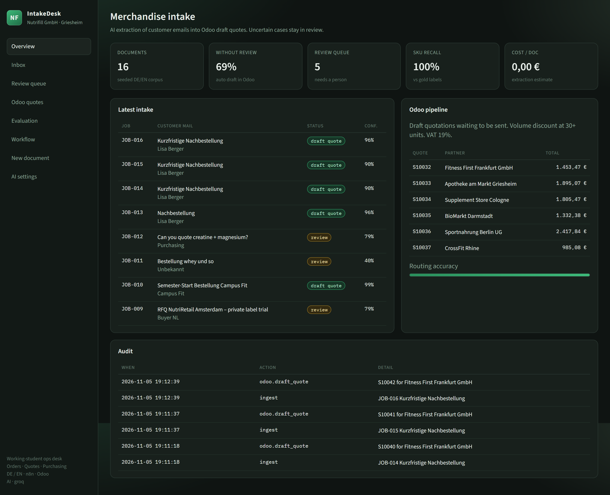
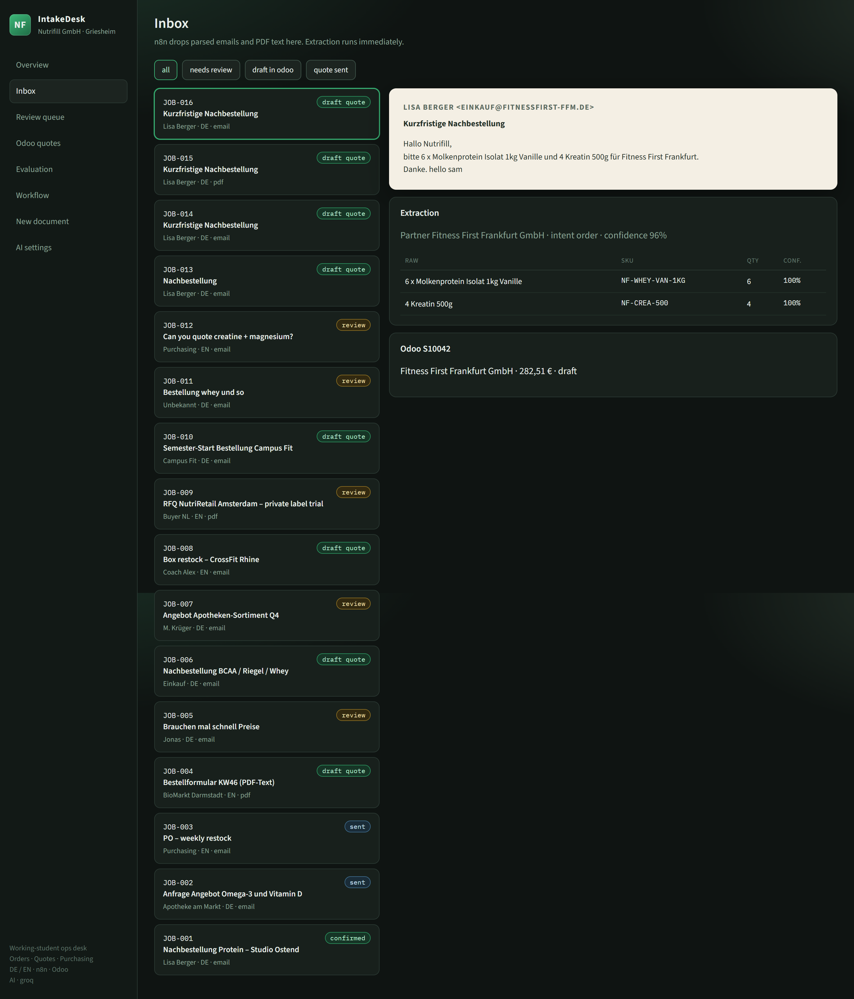
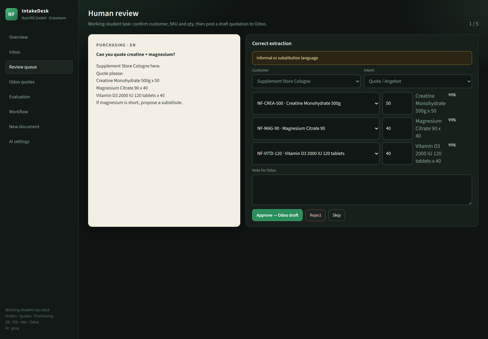
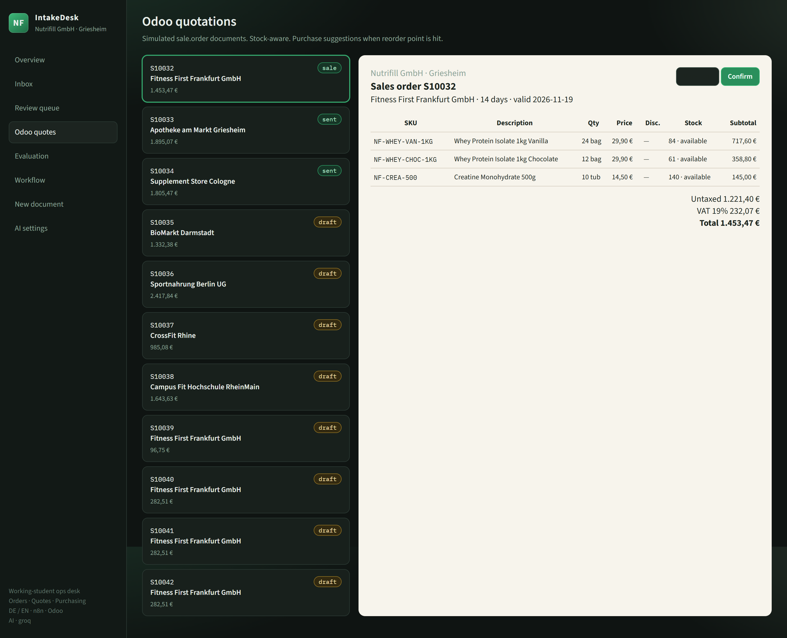
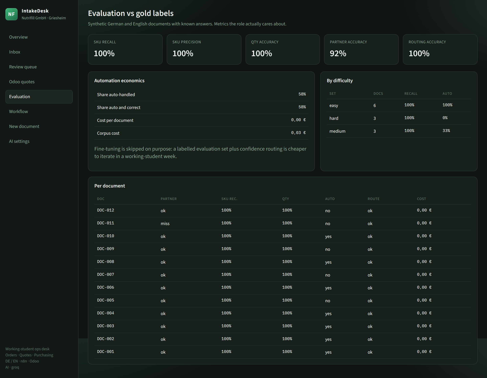
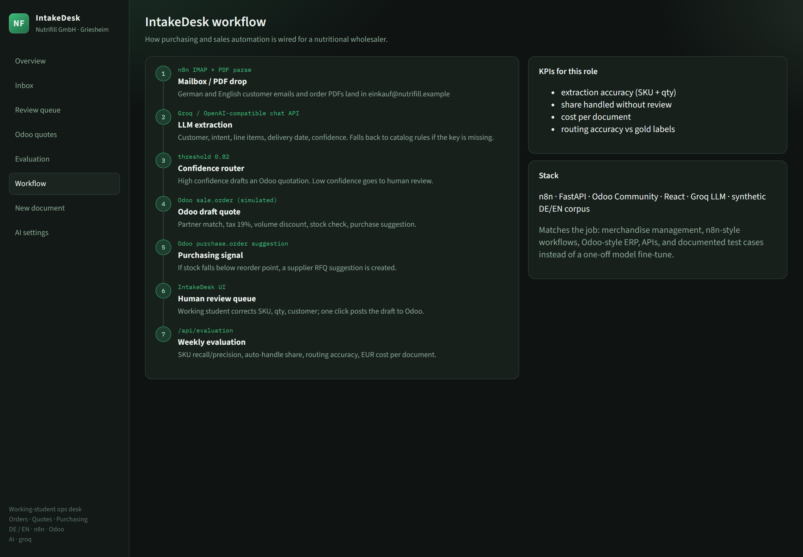
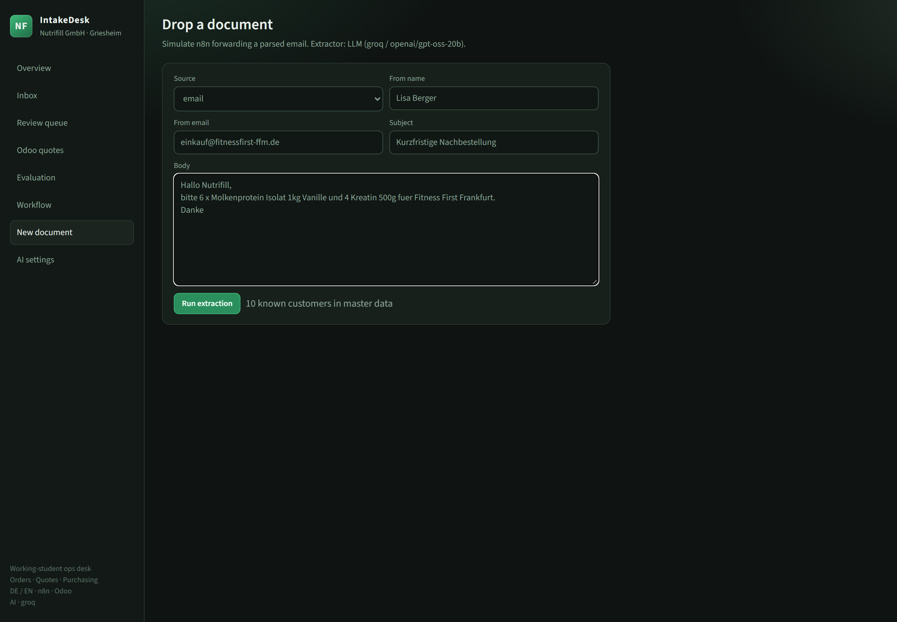
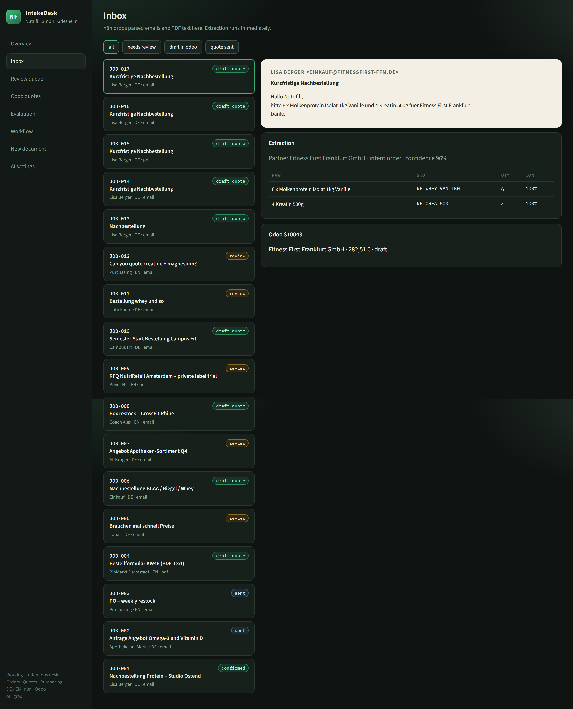
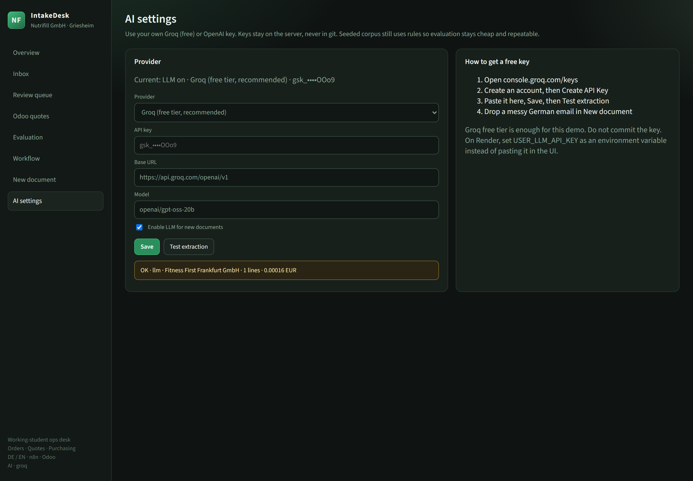

# IntakeDesk — full project walkthrough

A guided tour of the AI order and quote intake desk for **Nutrifill GmbH** (Griesheim / Frankfurt).
Customer emails and PDFs in German and English are turned into structured line items, priced
against a product master, and posted as **Odoo draft quotations**. Anything uncertain is routed to
a human review queue instead of being guessed.

- **Live demo:** https://intakedesk-yukj.onrender.com
- **Source:** https://github.com/Panth19/intakedesk

> Screenshots below were captured from the live Render deployment.

---

## 1. What the project does

| Step | Input | Output |
| --- | --- | --- |
| Intake | Email / PDF text from a customer | A job in the Inbox |
| Extraction | LLM + catalog grounding | Customer, intent, language, line items, confidence |
| Routing | Confidence threshold `0.82` | Auto draft quote **or** human review |
| Odoo | Matched partner + SKUs | `sale.order` draft, 19% VAT, volume discount, stock check |
| Purchasing | Stock below reorder point | Supplier RFQ suggestion |
| Evaluation | Gold-labelled DE/EN corpus | SKU recall/precision, routing accuracy, cost per document |

The design deliberately skips model fine-tuning. A labelled synthetic corpus plus a confidence
router is cheaper to iterate in a working-student week and gives measurable quality.

---

## 2. Architecture

```
 IMAP mailbox / PDF drop (n8n)
            │
            ▼
  POST /api/webhook/n8n  ──┐
  POST /api/ingest ────────┤
                           ▼
                 Extraction (backend/app/llm.py)
                 ├─ Groq / OpenAI-compatible chat model
                 │    grounded with the product + customer catalog
                 └─ deterministic catalog rules fallback
                           │
                           ▼
                 Confidence router (0.82)
                    │                 │
              high confidence     low / ambiguous
                    │                 │
                    ▼                 ▼
          Odoo draft quote      Human review queue
          (odoo_sim.py)          (React UI)
                    │                 │
                    └───────┬─────────┘
                            ▼
                  /api/evaluation (metrics vs gold)
```

**Stack**

- **n8n** — mailbox and PDF intake (`n8n/nutrifill_intake_workflow.json`)
- **FastAPI** — extraction, review, Odoo simulation, evaluation, static UI hosting
- **Groq GPT-OSS 20B** — live extraction (any OpenAI-compatible API works)
- **React + Vite** — ops desk UI
- **Odoo Community (simulated)** — `sale.order`, partners, stock, VAT, purchasing signals

One Docker image builds the React app and serves it from FastAPI, so deployment is a single
web service.

---

## 3. Screen-by-screen walkthrough

### 3.1 Overview — the operational picture



The landing page answers the questions a buyer or ops lead actually asks:

- **Documents / Without review / Review queue** — how much of the intake is automated and how
  much still needs a person.
- **SKU recall** and **cost per doc** — extraction quality and the price of each extraction.
- **Latest intake** — the most recent emails with status badges (`draft quote`, `review`, `sent`).
- **Odoo pipeline** — draft quotations waiting to be sent, with totals in EUR.
- **Routing accuracy** — share of documents the confidence router classified correctly.
- **Audit** — append-only log of every intake, draft-quote and settings action.

### 3.2 Inbox — raw mail and its extraction side by side



The Inbox is where n8n drops parsed emails and PDF text. On the left is the document list with
status filters (`all`, `needs review`, `draft in odoo`, `quote sent`). On the right you see:

- the original message (sender, subject, body) rendered as a "paper" preview;
- the **Extraction** card: matched partner, intent, overall confidence and every line item with
  raw text, resolved SKU, quantity and per-line confidence;
- the generated **Odoo quote** with its total, when the document cleared the threshold.

Unknown products stay visible with an empty SKU so the operator can fix them in Review.

### 3.3 Review queue — the human-in-the-loop step



Documents below the confidence threshold land here. The working student can:

- confirm or change the **customer** and the **intent** (quote vs order);
- remap each line to a catalog **SKU** and correct the **quantity**;
- add a note for Odoo;
- **Approve → Odoo draft**, **Reject**, or **Skip** to the next job.

Highlighted amber banners explain *why* the document needed a human, for example
"informal or substitution language" — the model understood the request but flagged ambiguity.

### 3.4 Odoo quotations — the sales document



A simulated Odoo `sale.order` view. Each quotation shows:

- partner and validity date;
- line items with SKU, description, quantity, unit price, discount and **live stock**;
- untaxed subtotal, **19% VAT**, and the gross total;
- a state workflow: `draft → sent → sale` (or `cancel`).

Stock-aware: if a line would drop a product below its reorder point, a purchase suggestion is
created (visible in the backend data and audit log).

### 3.5 Evaluation — quality against gold labels



Every seeded document carries gold labels. The page reports:

- **SKU recall / precision / quantity accuracy** — did we extract the right products and amounts?
- **Partner accuracy** — did we identify the right customer?
- **Routing accuracy** — did the confidence threshold send each document to the right place?
- **Automation economics** — share auto-handled, share auto-and-correct, cost per document,
  corpus cost.
- **By difficulty** — easy / medium / hard buckets, which shows where the hard cases are.
- **Per document** — a row-level audit with partner hit/miss, SKU recall, auto flag, route flag
  and cost.

The seeded corpus is extracted with catalog rules so this page stays stable, repeatable and free;
live documents use the LLM.

### 3.6 Workflow — how the automation is wired



The seven-step pipeline rendered straight from `/api/workflow`: mailbox / PDF drop → LLM
extraction → confidence router → Odoo draft quote → purchasing signal → human review → weekly
evaluation. It also lists the KPIs for the role and the stack.

### 3.7 New document — drop a live email



A form that simulates n8n forwarding a parsed email (source, sender, subject, body). The header
shows which extractor will be used: `LLM (groq / openai/gpt-oss-20b)` or catalog rules.

Pressing **Run extraction** sends the document through the real pipeline.

### 3.8 Extraction result — messy German email to draft quote



The same email now appears at the top of the Inbox as **JOB-017**:

- partner recognised as *Fitness First Frankfurt GmbH* with **96%** confidence;
- line items mapped to `NF-WHEY-VAN-1KG` (qty 6) and `NF-CREA-500` (qty 4), both at **100%**;
- a draft Odoo quotation **S10043** for **282,51 €** created automatically.

No human touch was needed because everything cleared `0.82`.

### 3.9 AI settings — bring your own key



Configure the extractor at runtime:

- provider: Groq (free), OpenAI, OpenRouter or any OpenAI-compatible endpoint;
- API key, base URL and model;
- enable/disable LLM for new documents;
- **Test extraction** runs a fixed German sample through the live model and returns the matched
  partner, intent, line count and estimated cost.

In production the key lives in the host's environment variables (`USER_LLM_API_KEY`), never in
git. The UI never returns the full key — only a masked form such as `gsk_••••OOo9`.

The screenshot shows a successful live test:
`OK · llm · Fitness First Frankfurt GmbH · 1 lines · 0.00016 EUR`.

---

## 4. The AI layer in detail

`backend/app/llm.py` sends a system prompt plus the email text **and a compact catalog brief** to
the chat API. Grounding the model in the actual product and customer master data is what turns
free text into stable SKUs, and it is why a small/cheap model is enough.

The model is asked for strict JSON:

```json
{
  "partner_id": "P-1001 or null",
  "intent": "order or quote",
  "language": "de or en",
  "requested_delivery": "string or null",
  "notes": "short note",
  "lines": [{ "raw": "snippet", "sku": "NF-... or null", "qty": 1, "confidence": 0.0 }]
}
```

The backend then *hydrates* the response: it re-resolves products and partners against the
catalog, recomputes prices, checks stock, flags unusual quantities, and computes overall
confidence. If the LLM call fails or the key is missing, extraction falls back to the deterministic
rule engine and the job is marked for review. That means **the app never breaks when the model is
down or unconfigured** — it degrades to rules.

Cost is estimated per request from token usage and the provider price table in
`backend/app/settings.py`.

---

## 5. API surface

| Method | Path | Purpose |
| --- | --- | --- |
| `GET` | `/api/health` | Health probe, reports `llm` or `rules` mode |
| `POST` | `/api/ingest` | Drop a parsed email / PDF |
| `POST` | `/api/webhook/n8n` | Same payload, called from n8n |
| `GET` | `/api/jobs` | List jobs (optional `?status=`) |
| `POST` | `/api/jobs/{id}/review` | Approve / reject with corrections |
| `GET` | `/api/quotes` | Simulated Odoo quotations |
| `POST` | `/api/quotes/{id}/state` | `draft` / `sent` / `sale` / `cancel` |
| `GET` | `/api/evaluation` | Gold-label metrics |
| `GET` | `/api/settings/llm` | Current AI configuration (key masked) |
| `POST` | `/api/settings/llm` | Update provider / key / model |
| `POST` | `/api/settings/llm/test` | Live extraction smoke test |
| `GET` | `/api/workflow` | Pipeline description for the Workflow page |
| `GET` | `/api/audit` | Recent audit entries |

---

## 6. Run locally

```bash
# Backend
cd backend
pip install -r requirements.txt
python -m uvicorn app.main:app --host 127.0.0.1 --port 8000

# Frontend (proxies /api to the backend)
cd frontend
npm install
npm run dev
```

Or `./start.sh` to start both. Copy `.env.example` to `.env` and set:

```bash
USER_LLM_ENABLED=true
USER_LLM_PROVIDER=groq
USER_LLM_API_KEY=gsk_...
USER_LLM_BASE_URL=https://api.groq.com/openai/v1
USER_LLM_MODEL=openai/gpt-oss-20b
```

Without a key the app still runs on catalog rules; messy emails simply route to review.

---

## 7. Deployment

The repo ships a single Dockerfile (Node build stage + Python runtime), a `.dockerignore`, and a
`render.yaml` blueprint.

**Render (current deployment)**

1. Get a free Groq key at https://console.groq.com/keys
2. Create a Docker web service from the repo, or use the Blueprint link:
   `https://render.com/deploy?repo=https://github.com/Panth19/intakedesk`
3. Set `USER_LLM_ENABLED`, `USER_LLM_PROVIDER=groq`, `USER_LLM_MODEL=openai/gpt-oss-20b`,
   `USER_LLM_BASE_URL=https://api.groq.com/openai/v1`, and `USER_LLM_API_KEY`.
4. Health check: `/api/health`.

Free instances sleep after ~15 minutes idle; the first request after sleep may take 30–60 seconds.
`DEPLOY.md` also covers Railway, Fly.io and Hugging Face Spaces.

---

## 8. Tests

```bash
cd backend
python -m pytest -q
```

The suite covers the rule extractor, DE/EN handled documents, confidence routing and LLM
settings/hydration behaviour (mocked calls). Current result: **9 passed**.

---

## 9. Repository map

```
backend/app/
  main.py        FastAPI routes + static UI hosting
  llm.py         LLM prompt, call, JSON hydration, fallback
  extractor.py   deterministic catalog/rule extraction
  catalog.py     synthetic product + customer master data
  odoo_sim.py    sale.order / stock / VAT / purchase simulation
  store.py       in-memory jobs, quotes, audit, evaluation seed
  settings.py    provider table + runtime LLM settings
  metrics.py     gold-label evaluation metrics
  documents.py   12 gold-labelled DE/EN documents
backend/tests/   pytest suite
frontend/src/    React ops desk (App.jsx, api.js, styles.css)
n8n/             importable n8n intake workflow
docs/screenshots walkthrough images
Dockerfile       two-stage build, serves UI + API
render.yaml      Render blueprint
```
